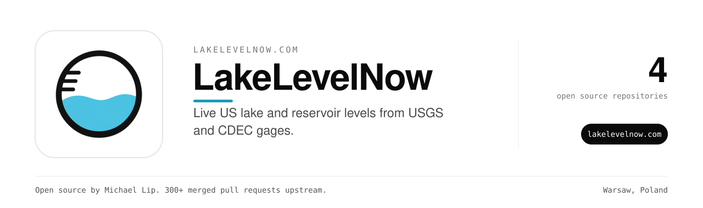

Live US lake and reservoir levels from USGS and CDEC gages.

Use it at [lakelevelnow.com](https://lakelevelnow.com).

### Repositories

| Repository | What it does |
| --- | --- |
| [lakelevelnow](https://github.com/lakelevelnow/lakelevelnow) |  |
| [reservoir-fullpool](https://github.com/lakelevelnow/reservoir-fullpool) | Full-pool elevations, operators and USGS/CDEC gauge IDs for 44 US reservoirs (Python) |
| [usreservoirs](https://github.com/lakelevelnow/usreservoirs) | R gauge crosswalk and full-pool reference for 44 US reservoirs (USGS/CDEC IDs) |

### Maintainer

Built and maintained by [Michael Lip](https://github.com/theluckystrike) in Warsaw, Poland.
He also fixes bugs in projects he uses. He has 300+ merged pull requests in 200+ outside repositories, including [urllib3](https://github.com/urllib3/urllib3/pull/5330), [Appium](https://github.com/appium/appium/pull/22911), [Prefect](https://github.com/PrefectHQ/prefect/pull/21916) and [Google Chrome extension samples](https://github.com/GoogleChrome/chrome-extensions-samples/pull/1629).
Need an engineer for your own product or AI agent? Send a written brief at [axdale.com](https://www.axdale.com/?utm_source=github&utm_medium=org&utm_campaign=hire&utm_content=lakelevelnow).
